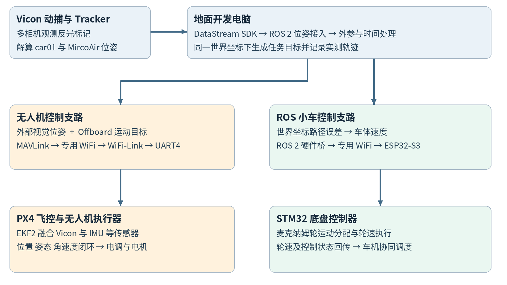

# Vicon 空地协同 · Robot Air–Ground

**用同一套 Vicon 空间定位驱动无人机与 ROS 2 麦克纳姆小车，实现自动就位、空中跟随、地面路径运动与返回缓降。**

本仓库整理自当前实验室工程，包含无人机任务与操作台源码、保留的标定杆小车控制版本、Vicon ROS 2 接收器、任务配置、离线测试和客户技术报告。无人机无需机载电脑，地面电脑负责协同计算，PX4 与小车控制器分别承担设备本地控制。

> **工程快照：2026-11-23。** 矩形跟随已有实机结果；直径 1.5 m 的联合圆周已完成离线实现，等待首轮实飞。公开源码保留现场路径与版本绑定，移植步骤见[部署说明](docs/DEPLOYMENT.md)。本仓库不附带运行凭据、私有放行记录或厂商 SDK 二进制。



## 项目重点

- **Vicon 进入真实反馈链路**：同一世界坐标中的 `MircoAir` 与 `car01` 为无人机外部视觉融合、小车路径控制和相对跟随提供观测。
- **车机坐标统一**：完成刚体到实体参考点的安装外参、机头映射、世界坐标与飞控本地 NED 配准；图形界面提供统一坐标位置对照。
- **随机起点自动就位**：小车从无人机不同侧接近，绕开静止无人机，最后在左侧约 0.51 m 刚体中心间距处同向并排。
- **连续动态跟随**：小车实测位置、速度前馈与受限参考轨迹共同生成无人机目标，复用 PX4 Offboard 位置/速度控制。
- **完整任务收尾**：无人机返回本轮地面起飞点，带动力缓降，接地后由飞控完成正常锁定；小车反馈确认停车。
- **统一操作与回放**：一次准备连接、分阶段就位和起飞确认、实时轨迹/速度/故障解释、RViz 三维、历史进度条与暂停回放。

## 已实现与下一步

| 项目 | 当前状态 |
|---|---|
| 单机自主起飞、悬停、四向与圆周 | 已实飞 |
| 小车标定杆遥操作 | 保留原版本及硬件桥 |
| 小车自动就位、从右侧绕至无人机左侧 | 已实车验证 |
| 0.5 m 高度、0.20 m/s、1 m 往返上方跟随 | 已实飞 |
| 3 m × 2 m 矩形跟随、返回及缓降 | 已实飞，数据见[验证记录](docs/VALIDATION.md) |
| 车速提升至 0.25 m/s | 当前配置，待实飞量化 |
| 直径 1.5 m、固定车头逆时针一圈 | 已离线验证，待联合实飞 |
| 5 cm 内重复落点 | 精度优化目标；记录中的矩形案例约 19.3 cm |
| 多机、动态障碍物、车上精准降落 | 后续扩展；当前主线在小车旁地面降落 |

## 阅读导航

| 读者/目的 | 入口 |
|---|---|
| 客户：了解价值、技术路线与成果 | [完整技术报告](docs/TECHNICAL_REPORT.md) · [PDF](docs/reports/Vicon空地协同技术报告.pdf) · [可编辑 Word](docs/reports/Vicon空地协同技术报告.docx) |
| 开发者：技术栈、数据、坐标与算法 | [技术报告](docs/TECHNICAL_REPORT.md) · [模块地图](docs/CODE_MAP.md) |
| 部署与操作 | [部署说明](docs/DEPLOYMENT.md) · [操作流程](docs/OPERATION.md) |
| 验收：哪些是实测、哪些是离线 | [验证记录与指标](docs/VALIDATION.md) |
| 来源与版权 | [第三方说明](THIRD_PARTY_NOTICES.md) · [源码哈希清单](docs/source-manifest.json) |

## 完整技术栈

| 层级 | 技术/设备 | 职责 |
|---|---|---|
| 空间测量 | Vicon 相机、Tracker、被动反光标记 | 刚体位置、姿态、有效性与帧信息 |
| 数据接入 | Vicon DataStream SDK、C++17、ROS 2 Jazzy | 同帧读取、毫米到米转换、PoseStamped / FrameSample |
| 地面计算 | Linux、Python 3、NumPy、ROS 2 rclpy | 外参、任务状态机、路线规划、跟随参考与日志 |
| 无人机执行 | MicoAir743v2、PX4 1.14.3、MAVLink、WiFi-Link | 外部视觉融合、Offboard 跟踪、姿态/动力控制 |
| 人工操控 | RadioMaster Pocket、TRS、SBUS | 独立遥控与接管 |
| 小车执行 | 麦克纳姆底盘、ESP32-S3、STM32、MC-Link/4WSE | UDP 接入、串口转发、轮速控制与反馈 |
| 观测展示 | Tkinter、RViz、ROS Marker、JSONL | 实时轨迹、速度、模式、故障及历史回放 |
| 开发验证 | pytest、合成运动学反馈、原始日志分析 | 算法/状态机回归与实机证据分层 |

## 仓库结构

```text
vicon_receiver_ws/
  src/ros2-vicon-receiver/          # C++ 接收器、FrameSample、原许可证
  drone_sim/
    tools/gamepad_rc/               # 当前统一任务入口、操作台、协同控制与测试
    ros2_ws/src/                    # UAV 坐标/消息桥与启动配置
vicon_mecanum_ws/
  candidates/wand_4wse_pose2000_20261105/ # 唯一保留的小车主机运行版本
  src/                             # 共享小车协议/控制与模型包
scripts/                           # 只做离线验证的仓库工具
validation/recorded/                # 精选结果摘要，不包含原始大日志
docs/                             # 技术报告、部署、操作、指标、图示
```

`gamepad_rc` 是历史目录名，当前主线采用 Pocket 专用遥控器。模块数量源于同一入口的协议、采集、状态机和恢复依赖，并非多个平行飞控框架。旧命名的依赖模块予以保留，旧候选小车版本、构建产物、原始飞行日志和固件备份未收录。

## 无硬件阅读与验证

```bash
python3 -m venv .venv
. .venv/bin/activate
python -m pip install -r requirements-offline.txt
python scripts/validate_offline.py
```

此入口只验证目标生成和联合任务几何/状态机，不连接串口、无线设备或 Vicon。现场操作台路径和迁移前提详见部署文档。GitHub 归档与现场工程分开管理，下载或测试本仓库不会自动启动车机。
