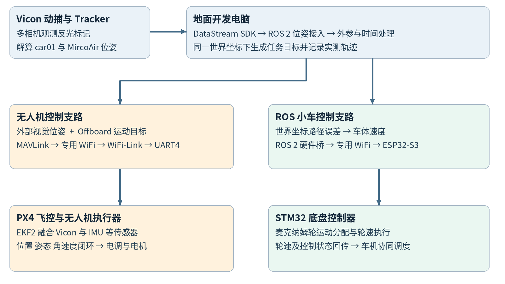
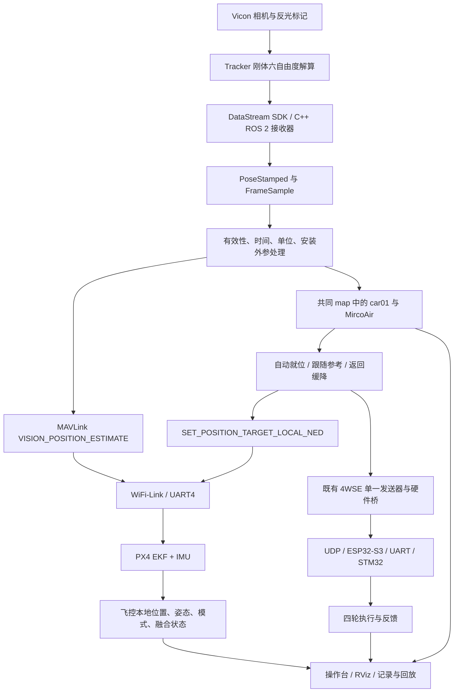
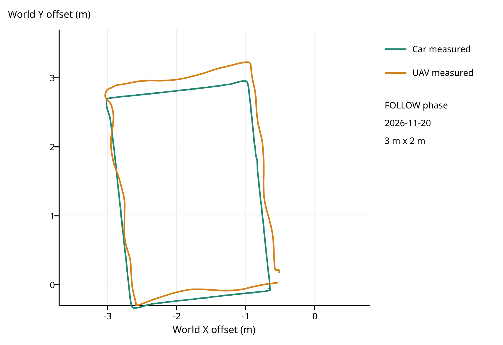

# 基于 Vicon 的室内单机单车空地协同技术报告

版本：2026-11-23 仓库发布版。对象：客户技术交流、方案集成与开发交接。

[12 页客户版 PDF](reports/Vicon空地协同技术报告.pdf) · [可编辑 Word](reports/Vicon空地协同技术报告.docx) · [最新实测与软件状态](VALIDATION.md)。PDF/Word 保留同日客户报告；本页补充当日新增的车侧绕行实测及联合圆周进度。

## 1. 项目用途与交付价值

项目面向室内机器人研发、设备演示与协同实验。使用 Vicon 为无人机和小车建立共同空间参考，地面电脑根据两者实时位置规划目标，无人机依靠 PX4 完成姿态与飞行动力控制，小车依靠既有控制器完成轮速执行。整体实现从观察位置、生成目标、执行运动到反馈评估的闭环。

用户可以把车机放置在覆盖区域内符合实体净空的位置，由小车绕开无人机并进入左侧并排待命位置。明确起飞后，无人机升高至约 0.5 m，移至小车上方并跟随路线；任务完成后小车回起点停车，无人机返回本轮地面起飞位置缓降。当前任务结束在地面，车上精准降落另列扩展方向。

核心工程成果包括统一坐标与外参管理、Vicon 到 PX4 的外部视觉链路、基于实测车速的无人机跟随参考、小车绕行自动就位、连续缓降状态机，以及能够解释故障并回放实测轨迹的统一操作台。

## 2. 系统架构与技术栈



| 子系统 | 当前组成 | 主要接口 |
|---|---|---|
| 动捕 | Vicon 相机、Tracker、固定反光标记 | DataStream SDK 帧、刚体位置/四元数、遮挡状态 |
| 主机 | Linux / ROS 2 Jazzy / C++17 / Python 3 / NumPy | ROS 2 消息、JSON 配置、JSONL 记录 |
| 无人机 | MicoAir743v2 / PX4 1.14.3 / MicoAir-WiFi-Link | UART4 ↔ MAVLink ↔ UDP |
| 遥控 | RadioMaster Pocket + TRS 接收机 | SBUS 到飞控，独立于任务电脑 |
| 小车 | 麦克纳姆底盘 / ESP32-S3 / STM32 | UDP、MC-Link/4WSE、串口与轮速反馈 |
| 展示 | Tkinter / RViz / ROS Marker | 实时轨迹、位置、速度、任务事件与历史回放 |

地面电脑使用有线网络连接 Vicon，两块专用无线网卡分别连接小车与无人机热点，办公网络单独保留。WiFi-Link 接在飞控 UART4，现有光流测距接口用于该数传，室内定位主线依靠 Vicon。机载端无需另加计算机。

## 3. 数据从相机到执行器的完整路线



1. Tracker 基于相机标定和刚体标记布局，输出 `MircoAir`、`car01` 的六自由度位姿。实体机头由安装外参定义，刚体名称保持一致仍需核对标记布局版本。
2. SDK 接收器在一次 `GetFrame` 内读取对象数据，位置由毫米转为米，姿态以四元数传递。`PoseStamped` 用于常规位姿；项目 `FrameSample` 保留同帧的采样、有效性与时间信息。
3. 主机把刚体原点换算到机体/车体参考点，保留世界坐标和时间语义，生成用于任务的成对车机观测。
4. 无人机外部视觉观测通过 MAVLink 经 WiFi-Link 进入飞控。PX4 EKF 将外部观测与 IMU 等已配置传感器融合，输出自身估计；主机发送目标，不替代飞控姿态内环。
5. 小车使用 Vicon 世界位姿计算目标误差，经既有硬件桥发送车体运动请求，ESP32-S3 与 STM32 执行协议转发及本地控制，回传轮速和故障。
6. 同一轮日志保存实测轨迹、参考轨迹、阶段、通信及收尾结果，操作台与 RViz 从日志读取展示，避免另开控制发送器。

### 3.1 关键消息与时间信息

| 数据 | 关键内容 | 作用 |
|---|---|---|
| `PoseStamped` | 世界位置、四元数、ROS 时间与 frame | 常规位姿消费 |
| `FrameSample` | `sdk_frame`、`sdk_epoch`、`sdk_hz`、`sdk_ok`、`occluded`、`sdk_pose/world_pose`、队列丢帧 | 同帧位姿与质量证据 |
| 主机时间 | SDK 调用起止单调时间、ROS 接收时间、源头 header | 数据年龄、时延配对和时钟跳变观察 |
| `VISION_POSITION_ESTIMATE` | 已换算位置、姿态、时间 | PX4 外部视觉观测 |
| `SET_POSITION_TARGET_LOCAL_NED` | 本地位置、速度前馈、航向与 mask | Offboard 目标跟踪 |
| PX4 遥测 | 本地位置、姿态、模式、融合/预飞、落地/锁定、电池 | 执行反馈与收尾判定 |
| 小车反馈 | 轮速、握手/时钟状态、故障位 | 运动闭环和停车确认 |

SDK 取帧时间、网络接收时间和相机曝光时间各有含义。`exposure_time_known` 显式表达曝光时间是否已取得；软件保留这些差别，不把主机收包时间改称相机采样时间。MAVLink 严格 CRC 用于判别完整有效帧；坏帧丢弃并记录，任务可用性还结合有效数据新鲜度和连续性判断。

## 4. 坐标系统与外参

设 `W` 为 Vicon 世界系，`R` 为某刚体系，`B` 为实体机体参考系。安装变换保存为刚体系中的机体原点 `p_RB` 和旋转 `R_RB`：

```text
p_WB = p_WR + R_WR · p_RB
R_WB = R_WR · R_RB
```

车机各有独立安装外参。重新摆放设备改变世界位姿，移动反光点或重建刚体可能改变安装关系；因此配置记录世界版本、刚体版本和外参证据。

ROS 常用 ENU/FLU 与 PX4 NED/FRD 通过明确旋转处理。标准 ENU→NED 向量变换为 `(x,y,z) → (y,x,-z)`，FLU→FRD 为 `(x,y,z) → (x,-y,-z)`；实际任务还需要本轮世界到飞控本地的平移与航向配准。对应实现位于 `frames.py`、`mavlink_vision.py`、`target_mapping.py` 与 `world_reference.py`。

操作台将飞控本地位置经本轮固定配准反变换回共同世界系，与 Vicon 机体参考点按时间配对，显示 `Δ=飞控−Vicon`。该值用于两路状态一致性分析；Vicon 测量精度、融合误差与最终控制落点分别统计。

## 5. Vicon 在两类设备中的关键作用

**无人机定位：** Vicon 提供室内外部位置/航向观测，PX4 EKF 结合 IMU 完成连续状态估计。Vicon 测量持续约束室内运动参考，使无人机能执行定点、轨迹与相对车体跟随。

**小车定位：** 轮速反馈描述执行器状态，Vicon 描述车体在实验室中的实际位置与朝向。控制器使用后者计算路径偏差，可观察轮滑、斜行及累计偏移，目标到达以外部空间位置为依据。

**联合定位：** 车机处于同一测量坐标系，可以直接构造左侧就位、车上方跟随和原地返回关系，并用同一轮实测数据评估速度、滞后及落点。Vicon 同时服务实时控制和结果评估。

## 6. 自动就位与路线规划

小车最终目标为无人机左侧、同向并排，中心间距约 0.51 m。算法将小车与无人机外框及参考点偏移计入膨胀包络，在配置的可行驶区域内建立可见图并选择可通行的绕行折线；转向阶段考虑实体扫掠范围，然后保持车头执行平移。当前避让对象是静止无人机，其他障碍由现场净空与任务边界管理。

截至本次快照，小车已实测从右侧经机尾后方绕至左侧，现场反馈路线正常。该路径没有给无人机发送运动请求。

矩形任务为前 3 m、左 2 m、后 3 m、右 2 m。新增联合圆周以就位后小车起点为圆周上的一点，圆心位于其左侧 0.75 m，先向前、逆时针一圈，车头固定。圆周采用 48 个路点、约 0.20 m 前视距离，并依据实测路径进度连续推进；最终回起点仍需停车反馈。

## 7. 无人机跟随算法

在共同世界系内，用小车机体参考位置加上车体系偏移生成目标：

```text
p_target_W = p_car_W + Rz(yaw_car) · offset_car
v_target_W = v_car_W + omega_car × (Rz(yaw_car) · offset_car)
```

上方跟随的水平偏移为零，高度按本轮无人机地面参考建立。速度项来自实测车体运动，带偏移的转动场景还包含旋转引起的速度分量。

参考生成器把目标位置差反馈与实测速度前馈结合，施加速度、加速度和制动约束，输出平滑位置与速度；经坐标映射后同时送入 PX4。这样减少仅追逐位置点形成的滞后，同时保留飞控自身估计和内环控制。

当前配置小车速度 0.25 m/s、加速度 0.10 m/s²，无人机参考速度上限 0.40 m/s、参考加速度上限 0.20 m/s²。参考上限是目标生成约束，实际速度以轨迹统计为准。

## 8. 返回、缓降与任务生命周期

任务阶段为：连接准备 → 小车自动就位 → 停车待命 → 明确起飞 → 升高 → 移到车上方 → 跟随路线 → 小车停车 → 返回本轮起飞点 → 连续下降 → PX4 接地/锁定 → 日志收尾。

当前配置正常下降参考速度 0.08 m/s；近地阶段保留有界水平纠偏，避免为追求小误差长期低空悬停。近地交接 PX4 LAND 完成接触判定及正常锁定，正常停桨发生在接地流程后。异常退出记录触发阶段与原始原因，操作台明确区分正常流程结束和未完成的恢复项目。

## 9. 现场结果与指标口径

矩形案例 `rectangle_prepare_20261120_155542` 使用 0.20 m/s 车速、0.50 m 跟随高度，完成四边、返回、缓降、落地锁定与停车。

| 实测项目 | 结果 |
|---|---|
| 巡航小车速度中位数 | 0.199 m/s |
| 巡航无人机速度中位数 | 0.207 m/s |
| 小车巡航速度 P05–P95 | 0.192–0.207 m/s |
| 无人机巡航速度 P05–P95 | 0.169–0.247 m/s |
| 此案例最终水平落点偏差 | 约 19.3 cm |

速度以同一路段、车速指令达到巡航条件的窗口选样，依据 Vicon 机体位置和主机单调时间进行 0.5 s 最小二乘拟合。不是轮速、指令值或单次像素测量。结果摘要在 `validation/recorded/`。



0.25 m/s 的参数与直径 1.5 m 联合圆周已进入软件基线，当前实机结果仍以上述 0.20 m/s 矩形为准。圆周运动学仿真用于检查阶段、路点推进和返回逻辑，实飞跟随与落点性能将在后续独立统计。

## 10. 操作台与客户展示

操作台提供车机实时轨迹、水平/垂直速度、飞控模式、位置对照、阶段与故障报文；RViz 提供网格、模型、实测轨迹和自由视角。历史记录按轮次归档，支持暂停与拖动时间轴；同轮现场视频可与轨迹回放同步剪辑。

“准备连接”检查专用网卡及已保存连接，再启动既有后端；“小车就位”与“确认起飞”保留独立操作。图形按钮复用统一运行入口，显示层没有第二套控制权。故障信息同时保留原始英文报文、中文原因与下一步处理建议。

## 11. 开发与客户实施路线

1. 完成场地相机标定、坐标定义、标记固定和两个刚体创建，保存版本。
2. 建立 SDK/ROS 2 接收、单位与坐标转换，核对实体机头与数据轴向。
3. 配置飞控外部视觉融合、无线链路、独立遥控和小车协议，建立静止数据基线。
4. 分别完成单机起降/平移、小车路线与自动就位，再接入统一联合阶段。
5. 先短距离往返，再矩形、圆周；使用同口径实测轨迹比较参数变更。
6. 按测量层、融合层、控制层分别验收：Vicon 重复性/遮挡恢复，融合连续性/位置差，跟随滞后/轨迹误差/落点。

下一阶段重点为联合圆周实飞、0.25 m/s 跟随量化和重复落点优化。扩展多机多车时继续复用共同空间参考，同时增加设备身份、链路容量和任务调度；加入障碍刚体后可扩展动态路径规划。

## 12. 交付范围

本仓库包含正式主机源码、ROS 2 接收与桥接、当前配置快照、测试、结果摘要与报告。原设备参数、标定/版本、网络身份与部署绑定在移植时按目标现场建立。PX4、Vicon SDK、ESP32/STM32 已烧录固件以外部依赖管理；此版本不分发厂商 SDK、私有刷写回执或整套固件构建树，详细接口与迁移条件见[部署说明](DEPLOYMENT.md)。
